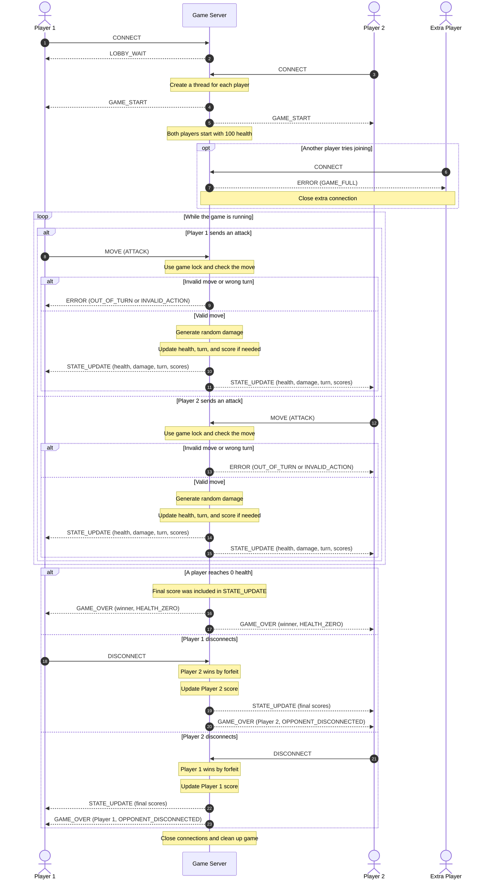

Sequence Diagram

This diagram shows how the two players will communicate with the server during a game of Terminal Dualz.

It starts with both players connecting, then shows how attacks are handled and how the server updates both players.

I also included what happens if someone makes an invalid move, disconnects, or wins the game.

How the Messages Work

The first player connects and gets LOBBY_WAIT since the server is still waiting for someone else.

When Player 2 connects, the server sends GAME_START to both players. Player 1 will go first.

After that, players can send MOVE whenever it's their turn. The server checks each move before doing anything.

If the move is valid, the server generates random damage and subtracts it from the opponent's health.

If someone tries attacking when it isn't their turn, the server sends ERROR and ignores the attack.

Keeping the Game Updated

The server will use a lock when checking moves and changing the game information. This is to prevent both player threads from changing something at the same time.

After an attack, the server sends STATE_UPDATE to both players.

The updates will include the new health values, damage, whose turn is next, and player scores.

Both players should receive the same information. The server will send the messages one after another while holding the lock, so another move can't change the game between the updates.

Scores and Ending the Game

The server will store the scores in a dictionary, like I explained in concurrency_design.md.

When someone wins, their score increases by one. The updated scores will be included in the last STATE_UPDATE before GAME_OVER.

GAME_OVER tells the players who won and why the game ended.

If someone disconnects during a game, the other player wins by forfeit. The server updates their score and sends them the final results.

The diagram shows players sending DISCONNECT normally, but the server will also handle unexpected disconnects if a client crashes or loses its connection.

After the game finishes, the server will close the old connections and reset the game so two new players can join.

Summary

This diagram shows how I'm planning to handle messages between the two players and the server.

The server will check moves, calculate damage, update scores, and send the results to both players.

I'm using the same message types from Sprint 1, with scores added to STATE_UPDATE. The main difference now is that both players will have separate threads, and the server will use a lock to avoid problems when they are both sending messages.
